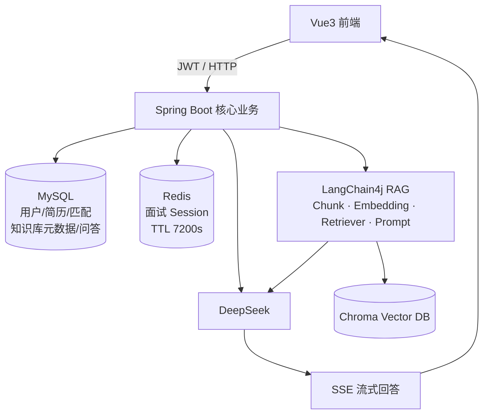
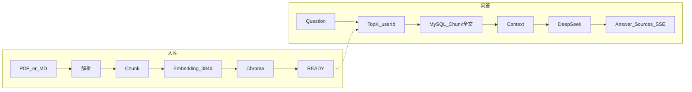

# 架构说明（可放简历 / GitHub）

本文与根目录 [README.md](../README.md) 配套：**图 1 总架构**强调 Java 主线；**图 2 RAG 流程**强调入库与问答两条链。

---

## 图 1 · 总体架构



### 文本版（方便贴简历）

```text
                         Vue3 前端
                            │
                         JWT/HTTP
                            ↓
                  ┌──────────────────┐
                  │  Spring Boot     │
                  │  核心业务服务     │
                  └────────┬─────────┘
                           │
          ┌────────────────┼────────────────┐
          ↓                ↓                ↓
       MySQL             Redis          DeepSeek
   用户/简历/匹配      面试Session     简历/匹配/面试/RAG
          │
          │ Knowledge RAG（Java 同进程）
          ↓
   ┌──────────────────────┐
   │ LangChain4j          │
   │ Chunk / Embedding    │
   │ Retriever / Prompt   │
   └──────────┬───────────┘
              ↓
       Chroma Vector DB
              │
              ↓
       Top-K + Sources
              │
              ↓
          DeepSeek
              │
              ↓
        SSE 流式回答 → Vue
```

### 为什么这样画（面试一句话）

- **Spring Boot** 是业务与 AI 编排中心：鉴权、持久化、简历分析、岗位匹配、面试、RAG。
- **面试一轮回答**用 Spring AI Alibaba Graph 做条件路由，节点内部仍调用 LangChain4j。
- **RAG** 的 Embedding、Chroma、Prompt 都在 Java 进程里。

---

## 图 2 · RAG 详细流程



### 文本版

```text
【入库】
PDF/MD → PDFBox / MdTextExtractor → PARSED
      → Chunk(~700, overlap~100)
      → Local Embedding(384d)
      → Chroma(chunk-{id}, user_id/document_id)
      → READY

【问答】
Question → 原问题 Embedding（无改写）
        → Chroma Top-K（user 隔离；底层 distance → LangChain4j score）
        → min-score 过滤（卡 score，越大越相关）
        → MySQL 取 Chunk 全文 → Context 注入 Prompt → DeepSeek
        → Answer + Sources（含 score）
        → 可选 SSE（meta / delta / done / error）
```

### 数据与隔离

| 存储 | 内容 | 隔离键 |
|------|------|--------|
| MySQL | 文档元数据、Chunk 全文、QA 记录 | `user_id` |
| Chroma | 向量 | metadata：`user_id` + `document_id` |
| 向量 ID | 稳定幂等 | `chunk-{chunkId}` |

重复 Ingest：先按 `document_id` + `user_id` 删除旧 Chunk / 向量，再写入。

### 检索分数语义（distance vs score）

| 层级 | 字段 / API | 语义 |
|------|------------|------|
| Chroma HTTP | `distances` | **越小越相似**（新建 collection 默认 cosine distance） |
| LangChain4j | `EmbeddingMatch#score()` | **越大越相关**，约 [0, 1] |
| 本项目配置 | `knowledge.rag.min-score` | 卡的是转换后的 **score**（`score >= min-score`） |
| 本项目 VO | `KnowledgeSourceVO.score` | 同上，给前端 Sources 展示 |

转换由 `ChromaEmbeddingStore` 完成（余弦情形大致为：`similarity = 1 - distance`，再经 `RelevanceScore.fromCosineSimilarity` 映射到 [0,1]）。业务代码不要把 `score` 当成 distance 解读。换 Embedding 模型后分数分布会变，`min-score` 需重新标定。

---

## 与「错误讲法」的对比

| 错误印象 | 本项目实际 |
|----------|------------|
| Python 做全部 AI，Java 只调 HTTP | 简历、匹配、面试和 RAG 都在 Java 进程里调用 DeepSeek |
| 向量库无隔离 | Chroma metadata + Service 层归属校验 + 403 |
| 只有同步问答 | 同步 `/ask` + SSE `/ask/stream` |
| `score` 就是 Chroma distance / 越小越好 | Chroma 返回 distance；业务用的是 LangChain4j 转后的 relevance score（越大越好） |
